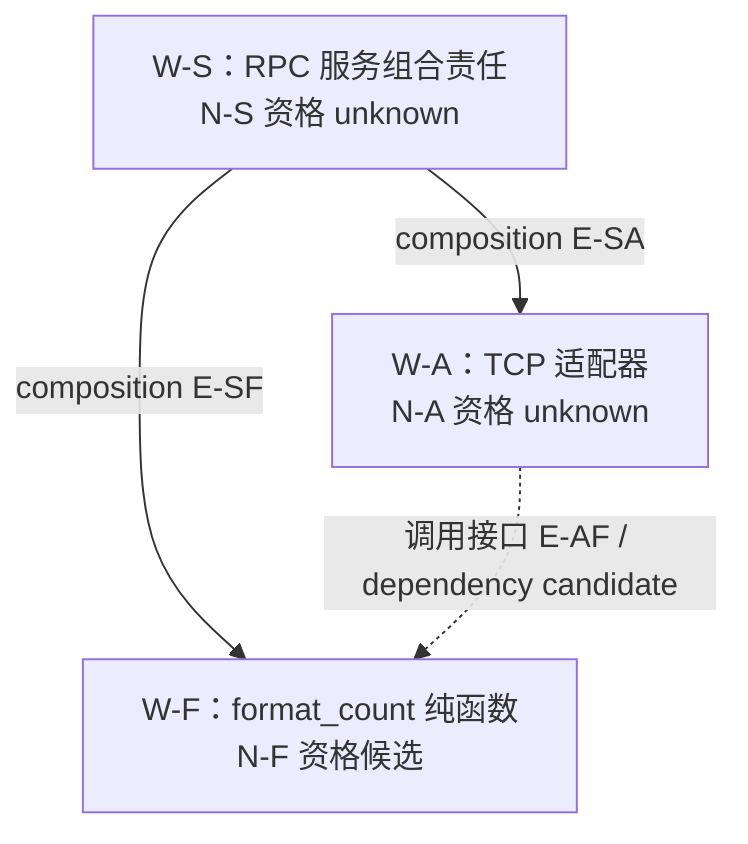

# OpenCode Mini / GPT：RPC 开发流程实测

## 当前结果（2026-10-23）

| 对象 | 当前结论 |
| --- | --- |
| Model attempt-1 | fail 已归档，保留建模与资源门禁问题 |
| Model attempt-2 / candidate-r2 | 静态 Check pass 并固定；后续行为反例又暴露类型谓词问题，不代表模型永久正确 |
| 函数 Implement attempt-1 | 真实 TDD 先红后绿；随后 Check 为 fail，已归档为 delivery_usable=false |
| 类型约束修订 | 已选择显式新版本，创建候选准备中；未覆盖旧模型 |
| TCP 适配器、组合根、独立 Verify | 尚未执行，完整 RPC 尚未交付 |

下文按发生顺序记录；早期“尚未”描述对应当时阶段，不能替代上表的当前结论。

## 范围与来源

用户委托测试操作员通过 tmux 控制 OpenCode Mini，使用真实 RPC 需求检验 PDCA。
操作员输入保留其身份，不能证明另一位真人亲自操作 TUI，也不自动改变 H1–H18 的验收状态。

- 运行时：OpenCode 2.1.2，`openai/gpt-6-astra`。
- fixture：`tests/.pdca-h11-live-20261022-01/`；规则副本 HEAD 为
  `7d9b3831d1c6615415731d57d4cefaa361fad571`。
- 绑定：`opencode-pdca-h11-20261022 / format-count`。
- 建模 task：`rpc-program-model-001 / attempt-1`。
- 原执行实例：`ses_e9cea1586ffe6VdqK7zGM2oO1g`，tmux 窗口 `pdca-h11-mini:gpt-rpc-model`。
- 需求：Python 3 标准库、自定义 TCP、4 字节大端长度前缀覆盖 UTF-8 JSON 字节数；
  方法 `format_count(n)` 接受非 bool 的整数 0、1、2，返回精确的 `count=N`，其他输入抛出 `ValueError`。
  纯函数的无状态、无外部 I/O 约束需与 RPC 传输职责分别建模。

任务记录位于 fixture 的
`pdca-root/records/projects/opencode-pdca-h11-20261022/workspaces/format-count/tasks/rpc-program-model-001/attempt-1/`。
原始工具/消息证据位于 fixture 的 `control/native-rpc-*`，只按下文具名目录读取。
原始记录留在本机；本报告不含凭据。

## 已观察的结果

| 环节 | 事实 | 对流程的意义 |
| --- | --- | --- |
| 创建与交接 | 原子任务仅创建一次；初始绑定预检失败时 dispatch 保持 unknown，同一实例恢复后对账 accepted / handoff_completed=true | 原生工具返回 completed 不足以证明任务已接收，需核对绑定、输入及原实例 |
| Plan 启动 | 原实例收到具名 Plan 操作，记录操作员来源，未将 Python 语言澄清误当作阶段授权 | 委托操作与需求事实可以分别追踪，但来源定位的持久性仍需复核 |
| 记录生成 | 一个 patch 同时添加再删除多余的 `transitions-placeholder-unused`，工具在校验时失败；该路径还在本 attempt 写域外 | 模型生成记录仍有路径与补丁可靠性问题，规则正确不等于每次输出正确 |
| 错误恢复 | 原实例检查部分写入情况后重新提交；主机另行核验多余路径不存在，产品 Git 工作区仍干净 | 该失败没有产品写入证据；不能隐去失败，只报告最终一次工具成功 |

创建/交接证据：`control/native-rpc-dispatch-reconcile-evidence/` 与 task 的 `dispatch.md`。
Plan 启动与失败补丁：`control/native-rpc-model-plan-start-evidence/`；
失败原生 call 为 `call_346700cf08094bef9c2c4b69c458881b`。
后续观测：`control/native-rpc-model-plan-tail-evidence/`，该次只观察，没有重复提交 Plan。

## Plan 完成与方案选择

Plan-01 已完成，原生最终消息为 `msg_16335d079001Ch3gumAoiuDI35`；完成证据在
`control/native-rpc-model-plan-completion-evidence/`。它实际固定了 R1–R3、AC1–AC7、
模型写域提案与协议选项，并在没有选择时保留 unknown，没有写产品代码。

本轮原生记录共含 36 次工具调用：19 次 read、8 次 shell、8 次 patch、1 次 skill；
34 次 completed、2 次 error。错误分别是多余占位路径的 patch 校验失败，以及上游 WebSocket 1011
传输错误。输入到最终回复的墙钟时间为 759.135 秒，包含操作员权限等待、工具与传输等待，
不能当作纯模型耗时或全部归因于 PDCA。原始统计见 `control/rpc-plan-01-native-summary.json`。

测试操作员随后选择 P-A 与共同边界。原实例新增 plan-v2/baseline-v2，把选择标为 Plan 完成后的
补充；原 v1 及 completion 摘要保持不变，并明确 v2 未被旧 completion 覆盖。证据在
`control/native-rpc-protocol-choice-evidence/` 与 `control/native-rpc-protocol-choice-tail-evidence/`。
Do 请求为 `rpc-do-01`，固定的 baseline-v2 SHA-256 为
`af981c4c983cf3599c464f49969fed4388c5511efaebe1923a7b318e59f02873`。

计划给出的有效约束包括：bool 和 2.0 不得被转换成合法整数、UTF-8 字节长度不等于字符数、
纯函数不能因传输层需要 socket 而被取消纯度约束。当前只证明这些约束被写入计划，尚无行为证明。

来源持久化仍有改进空间：前两次 response 的 source_ref 只有“本原生会话当前消息”，host event 为 null。
原生 API/SSE 实际有稳定 ID。观察器现已在收到输入时保存小型原生事件回执，供执行实例读取；
Do 输入 `msg_1633ebb8f001YrlcFjbGkxmXVJ` 已收到。旧输入的补充回执也单独保存，不重写旧基线。
这项改进降低恢复时对完整 transcript 的依赖，不替 CONFIRM 作授权判定。

## Do 暴露的资源检查顺序问题

原实例先写 `transitions/003-do-started.md` 并把 task 投影为 running，之后读取 flow-do 才检查
集中 `records/resources`。原生 call `call_e4ffa934a15b4552894fe006245242a5` 因
`permission.rejected` 失败。它停止且没有写模型，但 task 暂时仍为 running。
证据在 `control/native-rpc-model-do-start-evidence/`。

这是两类问题：fixture 没有资源目录及相应读取权限；同时，执行实例在缺少该项核验时过早宣称
Gate ready。flow-do 的写前检查确实阻止了后续写入，但不能使先前的 ready 判断成为完整核验。
因此应把本 phase 必需的资源读取与冲突证据前移到启动前，并让失败后的状态导航反映实际停止。

操作员仅初始化空目录、追加目录及元数据两条 read allow，原生 reload 返回 204，有效权限核对一致。
配置从 `44fcec73bc28b810e7b7b51c16a497339335aa8757258e8f7e099f92b42fcee3` 更新为
`c85a99c62c8709b378a507bee685057bf88391def2fd9909a18c7ac553583338`，没有追加资源写权。
原实例重新进入同一 do-01，原生 read 成功返回空目录，并在 `recovery-do-01.md` 明确承认旧 Gate
遗漏，保留旧 started receipt；`capability-resource-read-delta.md` 只记录本次读取增量。
这些事实不构成后端排他锁或资源 ownership 的证明。

## 实际建模产物

同一 do-01 已完成，见 `control/native-rpc-model-do-completion-evidence/`。
候选位于 fixture 的
`pdca-root/ontology/projects/opencode-pdca-h11-20261022/works/rpc-program/candidate-a1-r1/`：
`model.md`、`tree.md`、`qualification.md`。
三文件清单摘要为 `9d7de837e32625388b9a1965a1854311b84f14aed1fb8d142755b80389937368`；
算法和逐文件摘要在 task 的 `ontology-revision-candidate-01.md`，不形成自哈希循环。

这次细化区分了 8 个 definitions 与 work instances、6 类关系和 8 条关系实例、9 项约束，
没有把消息对象、文件目录或调用顺序直接变成任务树。节点仍为 candidate；其中根与适配器的资格
明确保持 unknown，没有提前生成正式 task seed。

U-ERROR、U-NUM、U-TIME、U-SEND 分别记录错误字段、超长数字解析、运行条件和发送失败限制。
已提交具名 Check-01 操作，要求审查这些影响，并核查 exact-int 细化及定义/实例层次；本节不预写其 verdict。

## 首轮 Check：fail

Check-01 已完成，原实例停在 `check / awaiting_confirmation`，没有修改被审模型。
原生证据：`control/native-rpc-model-check-evidence/` 与 `control/native-rpc-model-check-tail-evidence/`。
结论记录为 task 的 `conclusion-check-01.md`，SHA-256
`894349f861d723afb6ee3cbfa4d641c007929cbe81dae0bbe857ee990f9e49d9`。

| 项目 | 结果 | 具体问题或证据 |
| --- | --- | --- |
| AC1 | fail | D-Q/D-B 定义单个请求/帧，W-Q/W-B 表示消息族/格式，L-ENCODE 未说明两个层次的对应 |
| AC7 | fail | exact-int 限定被归为 R1/R2 原文，但原始来源与 Plan 没有该限制 |
| AC2、AC4 | unknown | 整数域、错误扩展字段及帧内超长整数的错误分类尚未闭合 |
| AC3、AC5、AC6 | pass | 仅模型中的 framing、纯度职责分离、组成/依赖区分；不是程序行为通过 |
| 流程历史 | 不符合 | 资源核验过晚、受阻后 running 导航未及时更新；恢复保留了真实失败 |

两个类型问题的反例方向由测试操作员提出，原实例随后对固定文件作审查；这是受辅助的同实例 Check，
不是盲测或独立新 Agent 审查。原始观察、反证及逐 AC 证据分别保存在 check-observations-01.md 和 evidence/。

本轮还暴露了返工规划问题：最初批准范围仅为 candidate-a1-r1 的三个文件；Check 后既要保留被审版本，
又要创建修订版本，新路径便超出既有边界。当前 REWORK 不允许偷偷扩大边界，因此普通模型修正被迫考虑
新 attempt。改进方向是提前固定本 work 的模型版本命名空间，同时让每次 Do 单独批准具体文件；
保留历史版本仍是要求，命名空间也不代表自动批准未来阶段。

操作员已为后续计划明确：接受非 bool 的 int 子类；错误字段采用固定集合；帧长允许范围内的合法 JSON
整数须保值解析，不能因运行时位数限制改变 INVALID_ARGUMENT 分类。这些是后补选择，旧 fail 不变。
Act-01 已完成并归档，最终状态为 `archive / completed`，
`delivery.md` 保留 `subject_conformance=fail`、`delivery_usable=false`。
原始模型、Plan/baseline、Check 结论及摘要保持不变；没有固定正式 ontology/tree/node 或实现 RPC。
原生证据在 `control/native-rpc-model-act-evidence/` 与
`control/native-rpc-model-act-tail-evidence/`，归档回执为 `transitions/009-archived.md`。

## 两轮之间的规则修订

首轮归档后，主仓库修改了三处规则，并将同样的文件同步到隔离规则副本：

- `ontology/concept/ontology-asset.md`：要求区分 schema/策略与单次值的层次，新增类型或错误政策必须标明设计决定及来源。
- `skills/pdca-plan/SKILL.md`：先固定任务可用的版本命名空间，再分别固定各次 Do 的具体产物与授权。
- `ontology/concept/pdca-gate.md`：集中资源元数据读取和权利核验须在 ready / phase_started 之前完成；空账本不等于取得资源。

同步前已核验没有活动执行；备份与补丁分别位于 `control/rpc-rules-before-update/`、
`control/rpc-rules-update.patch`。规则来源清单为 workspace 下
`capability-checks/evidence-gpt-20261022/rules-update-after-attempt-1.json`。
副本 HEAD 未变，这三项是明确记录的未提交变更，不能仅用 HEAD 指代新规则。

Skill 格式检查和这些文件的 `git diff --check` 已通过；这仅证明机械格式。
修订版本空间和模型层次的行为验证仍在第二轮进行。

## 第二轮：创建与启动前资源反例

同一 root task 的 attempt 2 已原生创建一次，新实例为
`ses_e9c7257dbffeVl5NptDvlzQ2VZ`，窗口为 `pdca-h11-mini:gpt-rpc-model-a2`。
创建/交接证据在 `control/native-rpc-attempt-2-create-evidence/`、
`control/native-rpc-attempt-2-handoff-evidence/`；dispatch 为 accepted，handoff_completed=true。
新 assignment 只引用固定需求、具名选择与必要规则，不采用旧失败候选或父/兄弟完整会话。

本轮先持久化 Plan subject/request，再发出独立批准，避免事后才补出待批准请求。
`plan-start-subject-v1.md` 摘要为
`bed84bdd157c9ea63f7eb7e017aeef31fa7b05febb45c0bfb2b37e5a2728a076`。
新发起的 shell 已核验 TMPDIR/TMPPREFIX 等实际路径；等待批准期间已准备好的上一条命令曾返回
旧环境，故配置写入回执本身仍不足以证明工具执行环境。

在所有会话空闲、资源目录为空时，操作员将 `records/resources` 暂移到 fixture 的 control 目录，
随后通过 Mini 批准上述具体 Plan 请求。原生 read
`call_f329504e48644deaa6703492a0255fda` 返回 File not found；实例明确拒绝沿用先前空目录的观察，
在写 decision 或 phase_started 之前停止。前后 task 目录的 8 个文件无增删、摘要全相同。
这支持“目录缺失须阻止启动”的本次回归通过，不证明所有资源冲突场景或后端排他能力。

证据在 `control/native-rpc-a2-plan-gate-probe-evidence/` 和
`control/resource-gate-probe/before.json`、`after.json`。同一目录已恢复，inode/mode 不变；
恢复后原生读取成功，先保存资源依据，再生成唯一 `001-plan-started.md`，同一 plan-01 已完成。
未另开 attempt，也未把先前失败改成启动成功。正常路径证据在
`control/native-rpc-a2-plan-recovery-evidence/`。

第二轮 `plan-v1.md` / `baseline-v1.md` 明确 schema/单次值层次、int 子类、精确错误包络与大整数语义，
并把 attempt-2 版本命名空间与本次 candidate-r1 三文件分开。Do-01 与 Check-01 的结果见下节；
同 attempt 内新版本返工的实际行为仍在测试。

该轮仍有生成可靠性问题：补丁 `call_ce9f06bad7624e26a7fcea1f925408cc` 把 project_id 路径误加 `-01`，
导致 task.md 更新预检失败。实例随后检查本 attempt 的 request/completion 尚不存在，再提交正确补丁。
这是实际路径生成错误，不能归咎于 provider 传输；最终完成不消除这条失败证据。

### 第二轮 Check-01 与同 attempt 修复

Do-01 的三个文件已固定，完整 payload 为
`84597abc6d723b5a10979376e975f1196e083c190e73cfb5d7861bee478f5bfc`。
本次 Check 输入只提供固定对象、基线和审查范围，没有附加具体漏洞提示。
同一原实例自行找到 F-01：D-JSON-VALUE 被限定为“解析所得”，其子类型 D-MESSAGE 却包含直接构造的响应值，
导致正常响应的类型归属不闭合。AC2=fail，其余五项仅在静态模型范围内 pass，整体仍为 fail。
结论摘要为 `80a1abef1509f4359ff5da91b573af87e336d0bd17836b647f57bdb5d0c2a9cc`；
证据在 `control/native-rpc-a2-check-evidence/` 及本 attempt 的 `check-observations-01.md`。
这是同实例 Check，不能称为独立新 Agent 审查。

本次准备并单独批准 `do-02 / candidate-r2`，保持原 Plan/baseline/AC 与业务语义，只修复该定义及必要版本引用。
新版仍在已批准的 attempt-2 命名空间内，旧 r1 和失败结论保留；没有先 Act，也没有新建 attempt。
Do-02 已完成；r2 完整 payload 为
`849f35b356dc069a38c42e8de2f6fae2b35ab8f2e9fbfc612eba48694d7d3702`。
原生实例采用三文件精确复制和最小补丁。操作员另行采集的
`control/rpc-a2-r1-r2-byte-diff.json` 确认 r1、assignment、Plan、baseline 与旧 Check 结论摘要不变；
实际差异仅含 JSON 值域修正及必要版本/provenance 同步。
这次已在原边界内完成新版本返工。Check-02 对 r2 重新核验全部六项 AC，结论为 pass，摘要
`953a032fd08dc2eef8a52b48dc4d60849b7b601b05f81dd9b023c480673f0f34`。
旧 r1 fail 继续绑定其原 subject。原生证据在 `control/native-rpc-a2-check2-evidence/`。

### 第二轮 Modeling Act 完成

Act-01 已单独批准并执行，`013-archived.md` 将 attempt 2 封存为 archive/completed。
`fixed-model-a2-r2.md`（摘要 `07d6020e2c07d3e1452cc8960c216768245237e1a72344bd61313d825851654c`）
固定 `rpc-program-ontology-a2-r2`、`rpc-program-tree-a2-r2` 及三个正式节点：
`rpc-program-root`、`rpc-program-format-count`、`rpc-program-transport-adapter`。
旧模型正文的 candidate/null 声明作为生成时历史保留，由外置固定记录表达本次 Act 事实。

证据在 `control/native-rpc-a2-act-evidence/`。delivery 的可用范围仅为已固定建模语义；
Implement/Verify 仍为 not_run，产品 Git 工作区仍干净。当前准备先从纯函数节点开始 Implement。
函数到适配器的实现交付仍 unknown，不能用模型固定替代实际实现依赖。

## 函数 Implement：创建交接与写域混淆

首个实现 task 为 `rpc-format-count-implement-001 / attempt 1`，原生实例
`ses_e9c1e79b9ffeAm1mc2ToSNsBMv`，仅负责 `rpc-program-format-count`。
创建时尝试让 child 直接保存待批准 Plan 请求，但阻塞式原生创建尚未返回，父端还未能保存真实
writer/conversation，child 因此停止。按 agent-dispatch 的既有顺序，应先保存回执与身份，
再续接同一实例核对绑定，accepted 后才展示 Plan。这是测试驱动的交接顺序需要修正，
不能仅据第一次停止认定本体或派发契约矛盾。

原实例随后完成只读绑定核对，真实末条消息 `msg_163f3b1b9001pRmYT0xRh7iiAE`，
assignment 摘要为 `749aad01c32f584c6c719d480ad9f493f0bad27cac6bf82481daa048d8443d61`。
其两条 Git 命令均显式设置工具 workdir 为规则副本，未把 TARGET_ROOT 的快照误作规则来源。
证据在 `control/native-rpc-function-handoff-bind-evidence/` 及 workspace 中的
`capability-checks/evidence-gpt-20261022/rpc-function-handoff-bind-observed.json`。

对账又发现独立问题：已批准 seed 指定两项产品候选，实际 assignment 的
`allowed_product_scope=[]`，project-context 的 `target_writes=[]`。
assignment 契约将这些字段定义为任务写域边界，不能因当前没有 Do 授权而清空整个任务边界，
也不能让未来 Plan 静默扩域。父实例在消息 `msg_163fcb9c7001q5t4BAcL3QGyqY` 中承认该生成错误，
随后通过固定的 work_action=migrate 纠正，未重新创建 task/attempt：

- review-02：`1f26f17dd44a578fc82024ed78e94f0ee4ed18493b33bd1b925fef734ec0212d`。
- 新 assignment-v2：`bb170c301f9f3f7f83b6426459ce612d15154ce5b6558025304005eb250751f0`。
- 新 project-context-v2：`4462a516411a24b48181912a145bcfc12a5ecf49f08a6a25b71bd3b2f6d6c36c`。

产品最大边界仅原两文件，记录最大边界仅当前 task/attempt 子树；每个 phase 仍需固定具体操作，
父子写者分界和历史保全继续生效。原 assignment/context/invocation 的摘要保持不变。
父端使用原生 continue 显式指定原 session，child 的只读确认消息为
`msg_1640be93d0018oeo3nmBsTqEyH`。证据在 `control/native-rpc-function-scope-v2-apply-evidence/`
及 `control/native-rpc-function-final-handoff-evidence/`；尚无产品实现。

主仓库据此补充 assignment 契约，明确任务边界与当次阶段授权的区别，并允许预先固定具名
attempt 的记录命名空间。本次运行仍使用修订前的 fixture 契约；当前成功纠正不等于新措辞已获
后续任务的行为回归。Mini runbook 同时记录阻塞式创建的交接顺序。

### 交接完成后的交互成本

v2 纠正经原实例确认后，父端仅更新创建控制记录，dispatch 已 accepted / handoff_completed=true。
随后原 child 保存具体 Plan subject/request，再收到单独 Plan 批准。
仅这一步“准备两个待确认文件”便有 23 次工具调用（12 read、8 shell、2 patch、1 skill），
从原生输入到最终回复为 332.224 秒；原始统计见 `control/rpc-function-plan-prepare-metrics.json`。
这包含操作员权限等待、provider、工具与模型时间，不能全部归因于 PDCA，但确实是本次操作成本。

当前实现 Plan 明确沿用固定节点/模型，采用标准库 unittest，并要求区分测试装载故障与实际行为失败。
这借鉴了已安装 Superpowers 的 TDD 和 verification-before-completion 方法：先观察失败，再实现，
把实际命令、退出码、输出和被测版本作为完成依据。此处只记录方法已进入具名 Plan 对象；
实际红绿测试结果仍须后续 Do 提供，不能用“采用 TDD”字样替代执行。

## 函数 Implement：真实 TDD 与新增反例

原实例完成 Plan 和 Do-01，当前实现为 TARGET_ROOT/src/format_count.py，测试为
TARGET_ROOT/tests/test_format_count.py。source SHA-256 为
`764d13dc7ca17d3bfca7a30e19506591566175a92628482ef0b7b91fde4b9589`，测试摘要为
`466e84375ee86b76071b1934ab310cdae07bb755949b17dcabfc35ed17a6c906`。

真实命令为 `python3 -B -m unittest discover -s tests -p test_format_count.py -v`，
cwd=TARGET_ROOT、PYTHONPATH=TARGET_ROOT/src。最小可导入的全拒绝 stub 得到 red：
9 个测试方法、39 个行为断言失败、0 errors、exit=1；实现后，同一测试文件得到 green：
9 个方法通过、exit=0，无 skip。原始输出与前后代码快照在函数 task 的 evidence/do-01/；
原生记录在 `control/native-rpc-function-do-evidence/` 与 `control/native-rpc-function-do-tail-evidence/`。

实现使用 `int.__index__` 提取真实整数值，因此现有测试中的整数子类重载、IntEnum、非法值及
常见 I/O 哨兵均通过。但这没有证明任意 Python 输入均满足约束。

Do 完成、原实例空闲后，操作员对同一未改变的 source 独立执行了三个具体反例：

| 输入对象 | 实际观察 |
| --- | --- |
| 非 int 对象的 `__class__` 属性返回 int | 抛 TypeError，而非 ValueError |
| 非 int 对象的 `__class__` 属性抛 RuntimeError | RuntimeError 直接逸出 |
| 非 int 对象的 `__class__` 属性记录访问并返回 object | 最终 ValueError，但属性被执行两次 |

前两例违反 source R2 的非整数拒绝契约；第三例是动态回调的具体观察，需进一步审查其纯度影响，
不能把它说成已经观察到外部文件 I/O。原测试器在 `control/audit-format-count.py`，原始输出为
`control/rpc-function-operator-audit-01.json`（摘要
`32629799455cf16a2d4c8e6ba95f50961fd4a472dd11154bf819b0f2c9670b93`）。
脚本退出成功只表示观察已保存，不表示被测函数符合。

已将两份原始材料作为补充线索交回同一实例的具名 Check-01，要求独立复现并区分来源语义、
模型谓词、Plan 选择与实际代码行为。本轮是带操作员反例的 Check，不能称为盲测或独立 Verify；
当前尚未接受该实现，TCP 适配器、组合根和独立 Verify 仍未执行。

Check 中原实例在自己的 evidence/check-01/ 内重新编写并运行 probe.py，复现 X1–X3；
它把动态 isinstance 的额外观测放到另一组新实例，避免观测器自身的属性访问混入函数调用计数。
随后自行扩展 probe-02.py，发现真实 int 子类且底层值为1也存在失败：getter 抛错会逸出
RuntimeError，getter 返回 bool 会误抛 ValueError，getter 记录访问时虽返回 count=1 仍修改外部列表。
两次原生观察前后被测源摘要相同，输出为 probe-01.stdout.json 和 probe-02.stdout.json。
这些新增反例支持继续审查 R1/F1 和 R3/F3；不能只修非法输入异常而遗漏合法子类。

### Check 记录写入失败与恢复

反例观察完成后，原生 patch `call_5622375640ed48d6acdbd084179220bd` 除 f1.md/f2.md 外，
还包含错误的 `records/projects/opencode-pdca-h11-live-20261022-01/pdca-root/unused` 路径，
因 edit 权限被拒。实例停止当前入口，没有换工具重试；此时最终 conclusion 和 completion 尚未保存，
task 导航仍显示 check/running。

操作员在实例空闲时只读检查该补丁的三个具名目标，均不存在；产品与基线摘要未变。
证据为 workspace 的 `capability-checks/evidence-gpt-20261022/rpc-function-check-recovery-observation.json`，
原补丁和工具错误另存 `control/rpc-function-check-rejected-patch.txt`、对应 tool.json。
随后通过 Mini 重新进入同一实例、同一 Check run，仅恢复原合法写域内的记录，不扩大权限，
不重做 phase_started；恢复证据在 `control/native-rpc-function-check-recovery-evidence/`。

错误补丁前曾出现 provider 的 60 分钟 WebSocket 连接上限错误；它与越域路径分别保留。
现有证据不能证明连接错误导致了错误补丁。路径生成仍需由执行实例核对，权限拒绝也不能被写成
记录保存成功。此处同时暴露了受阻后 running 导航滞后的问题。

恢复后同一 Check run 完成，`006-check-completed.md` 保持单一 started/completed 链。
最终 conclusion 摘要为 `085d0bfdd264f4a4e8d3ff9d6043f902af9419ae0f622b9b625c17aa76a37b29`：
F1/F2/F3 fail、F4 unknown，subject_conformance=fail。原始 TDD 历史有效，但不能覆盖这些反例。
固定 C-F 使用 `isinstance` 表达式，Plan 又明确采用其动态语义，因此原实例没有强造同 attempt
Do 候选。操作员选择现在明确实际非 bool int 继承关系及底层整数值，排除实例属性回调参与
类型判定；这是新修订决定，不追溯为旧模型已明确的事实。后续需版本化 Model 修订和新的
Implement，旧模型、Plan 和失败保留。

主仓库 ONTOLOGY-01 据此补充 predicate 的审查：区分规范性求值机制与语义示意，并检查
动态属性访问、重载及转换对输入域、错误和其他 invariant 的影响。该补充尚待新任务运行验证，
不能把文档修改记作行为回归通过。

旧函数实例随后按独立 Act 请求完成 `007→008→009`，当前 archive/completed，
delivery_usable=false。最终 delivery 摘要为
`4085748996c4366cc459913fdb65a39c34cf3fb9ce5d2cf3d88f9ad712cacae7`，
archived receipt 为 `d307d835d2af69deed79ea64cc7f051f0ae830e77706447d1cee243f8b93a530`。
保留失败产品和模型；无发布、产品修改或 Git 提交，没有伪造资源释放。
证据在 `control/native-rpc-function-act-evidence/`。

该 Act 原生共 15 次工具调用（5 shell、4 patch、5 read、1 skill），输入至最终回复
467.072 秒，原始统计为 `control/rpc-function-act-metrics.json`。包含操作员及宿主等待，
不能全部归因于规则；但纯记录终态处置的实际操作成本应纳入后续简化评估。

### 类型修订创建的宿主观察

旧实例归档、父子均 idle 后，操作员将 ONTOLOGY-01 rc.7 和 assignment 契约 rc.6 同步到
隔离规则副本。逐文件旧/新摘要与备份见 `capability-checks/evidence-gpt-20261022/type-domain-rules-update.json`；
规则 Git HEAD 未变，现有四处未提交修改明确保留，不把同步当作运行验证。

首次创建输入的操作器提示误带一个零宽字符 U+200B；Mini 将它从 CONTEXT 单词中移到末尾，
其他文字相同，严格全文匹配因此未保存预定回执。父实例因该精确回执不存在而停止，未写创建
记录、未消费批准或 spawn。原事件 `evt_16461c942001lTSyGTV8BORvOW` 与实际文字保存在
`control/native-rpc-type-domain-model-create-evidence/`，之后只补充真实事件回执并续接同一请求。
这属于操作器输入/取证问题，不能归因于 Model 规则。驱动已增加提交前格式字符检查；
新恢复输入正常捕获为 `msg_1646532e00013O08QbNS55ugyA`，未重新提交原创建文字。

本轮还发现操作员外部 shell 未默认设置 TMPDIR/TMPPREFIX；此前外部 here-document 的临时
路径没有被同等核验，不能用原生 Mini 的隔离证明全部操作员命令都未碰触 /tmp。
之后辅助命令显式使用 fixture 的 operator-env.sh，提示通过文件写入；不再运行外层 here-document。

新 Model task 只创建一个真实实例 `ses_e9b95fd0fffeZhz8DdjIiNV8qF`。首次排队的 shell 仍观察到
旧 TMPPREFIX=/tmp/zsh，因此正确停止且未读 records；设置 session environment 后，原实例新命令
`call_430493e5596748f493cbcdda8d00afb9` 确认 fixture/tmp/zsh。只读绑定确认消息为
`msg_1647644310017vEWQb22sqPSYJ`；当前 assignment 采用 rc.6，模型最大写域正确保留，
TARGET_ROOT 产品域为空，接收确认不要求 dispatch 先 accepted。该过程带明确操作员引导，
不能当作无提示对照实验；正式模型阶段仍待独立启动。

父会话原生上下文压缩保持同一 session，并保留磁盘记录和历史事件。现场 OpenAPI 支持的
compact 请求已实际执行；压缩前一条回复的有效输入为285011 token（1491未缓存+283520缓存），
接续交接核验的一条调用为44808（3720+41088）。压缩本身读取285719、输出2638 token。
原始计数在 `control/rpc-parent-compaction-observation.json`；这是上下文成本观察，
不是延迟对照测试，也不证明 PDCA 语义正确。

## 环境与流程问题的区分

此前已通过独立实测修复的宿主接入问题，见
[Mini v2 操作说明](../../tests/opencode-mini-v2-runbook.md)：版本对应的原生 interrupt 接口、
配置合并、GPT 的 patch 工具、精确目录读取权限及 zsh 的 TMPPREFIX。
这些修复支持继续执行测试，不证明本体语义、实现或行为验证通过。

当前观察继续针对需求覆盖、定义/工作实例、关系与约束、候选与固定版本边界、
同一节点的实现映射及正反行为证据。完整 Model → Implement → Verify 尚未完成。
